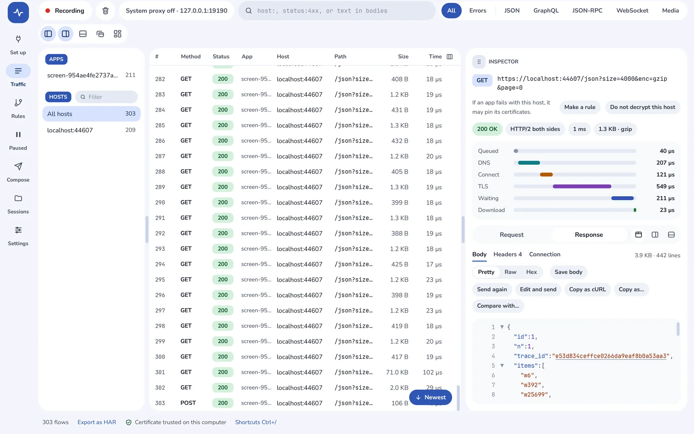
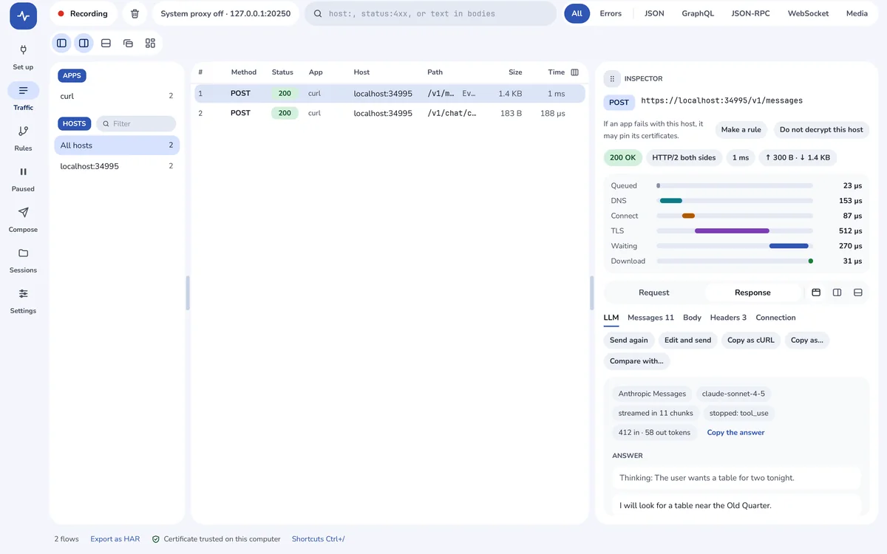
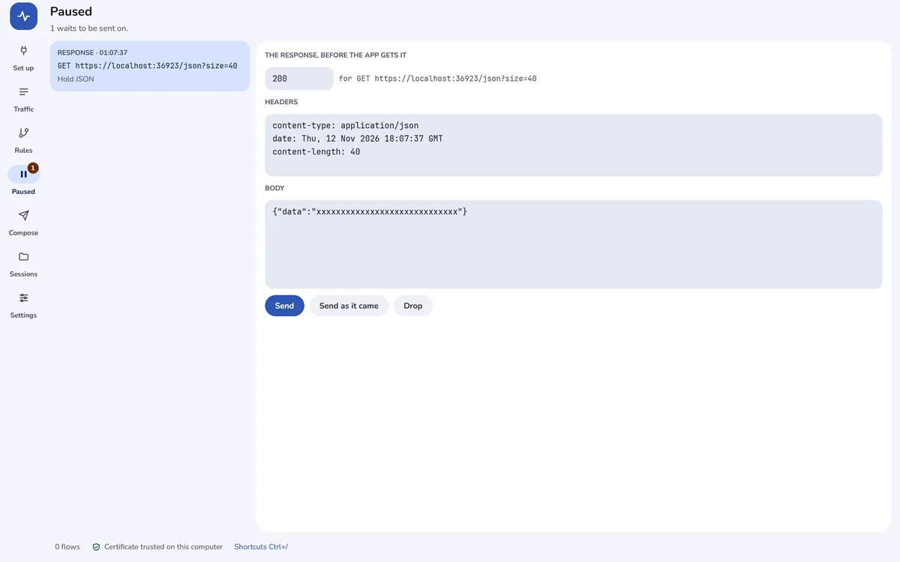
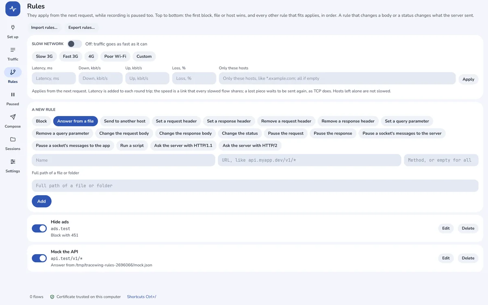
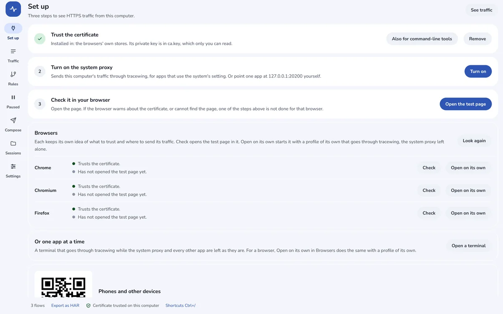

<p align="center">
  
</p>

<h1 align="center">tracewing</h1>

<p align="center">
  <b>The HTTP(S) debugging proxy that keeps up with big sessions.</b><br>
  For everything your browser's DevTools can't see: mobile apps, desktop apps, servers and AI agents.<br>
  See, pause and change every request they make. Native, for Windows, macOS and Linux.
</p>

<p align="center">
  <a href="https://tracewing.app"><b>tracewing.app</b></a> ·
  <a href="https://tracewing.app/#get">Download</a> ·
  <a href="docs/features.md">Features</a> ·
  <a href="docs/scripts.md">Scripts</a>
</p>

<p align="center">
  <a href="LICENSE"></a>
  
  
</p>

<p align="center">
  
</p>

## Why tracewing

- 🔍 **See every request.** HTTP/1.1 and HTTP/2, WebSocket, server-sent events, gRPC and GraphQL, over HTTPS through a certificate authority made for your computer alone.
- ⚡ **Big sessions stay smooth.** A million requests scroll at your display's pace, and large bodies stream through instead of piling up in memory.
- 🔬 **Read what is inside.** JSON, XML, Protobuf, MessagePack and CBOR laid out; tokens, cookies and timings explained; two requests compared side by side.
- ✋ **Pause and edit.** Breakpoints hold a request or a response, and WebSocket messages too, until you send it on, changed or not.
- 🔀 **Change traffic on the way.** Rules block, answer from a file, send to another host, rewrite headers and bodies, or slow the network down. For the rest, a few lines of JavaScript.
- 🤖 **Made for AI work.** LLM API streams put back together, tokens and tool calls, and an MCP server so your AI tools can search and read what tracewing recorded.
- ⛓️ **Web3 too.** JSON-RPC calls and their calldata read by your contracts' ABIs, and a warning when an edit breaks a signed transaction.
- 📱 **Phones and emulators.** Set up from a QR code, with Android emulators (14 and later too) and the iOS Simulator trusted in one click.
- 🏢 **Works at work.** Through your company's proxy, NTLM included, with your company's own CA, client certificates and TLS keys for Wireshark.
- ⌨️ **No window needed.** `tracewing capture` records on a server or in CI, and writes HAR.
- 🌍 **Made for every day.** 15 languages, light and dark, a text size of your choice, and layouts you can name. It runs on your computer and sends nothing anywhere.

Every feature in detail: [docs/features.md](docs/features.md).

<table>
  <tr>
    <td></td>
    <td></td>
  </tr>
  <tr>
    <td></td>
    <td></td>
  </tr>
</table>

## Download

tracewing's first release, 0.1, is on its way: it will be at **[tracewing.app](https://tracewing.app/#get)** and in [GitHub Releases](https://github.com/hivepaas/tracewing/releases). Until then, build it from source.

## Command line

```sh
tracewing capture --seconds 60 --har api.har
tracewing sessions
tracewing export --har today.har --filter "host:api.example.com"
tracewing recover                 # no network after tracewing was killed? this
```

`tracewing help` lists the rest.

### No network after tracewing was killed

While the system proxy is on, this computer sends its traffic to tracewing. If
tracewing is killed, the setting stays behind and points at a port nothing
listens on, so **every program on the machine loses the network** — browsers
first, and nothing says why.

tracewing puts the setting back when it is closed, when it next starts, and from
a watchdog process the moment it dies. On Linux a systemd user timer stands
behind those: once a minute it looks for a journal left by a tracewing that is
gone, which is the case the watchdog cannot cover because `pkill tracewing`
takes the watchdog with the app. **The network comes back by itself within a
minute**, and the timer is armed and disarmed with the setting, so nothing of it
is left when the setting is off. macOS and Windows have no such timer yet: there
the next login is what puts it back.

To have it back now, or on an OS with no timer, one command undoes it:

```sh
tracewing recover
```

It restores the settings tracewing wrote down before it changed them, and leaves
them alone if they are no longer tracewing's. Starting tracewing again does the
same. `tracewing recover --only-if-gone` is the same thing with a running
tracewing left alone, which is what the timer runs and what a script of your own
should run.

## Build from source

```sh
make release
```

Then point an app at `127.0.0.1:9090`. What it needs, the tests and a server to try it on: [docs/building.md](docs/building.md).

## 🐝 Made by HivePaaS

HivePaaS also makes [shellwing](https://shellwing.app), a fast native SSH client, [packwing](https://packwing.app), the file archiver that uses every core you have, [authwing](https://github.com/hivepaas/authwing), two-factor codes that know the window you are in, and [hivepaas](https://github.com/hivepaas/hivepaas), a self-hosted PaaS.

⭐ If tracewing is useful to you, a star on GitHub helps others find it.

## License

tracewing is free software under the [GNU General Public License, version 3](LICENSE) or later. The name and logo are not covered by the GPL: see [TRADEMARKS.md](TRADEMARKS.md). Contributions are welcome: see [CONTRIBUTING.md](CONTRIBUTING.md).

Copyright © 2026 HivePaaS.
